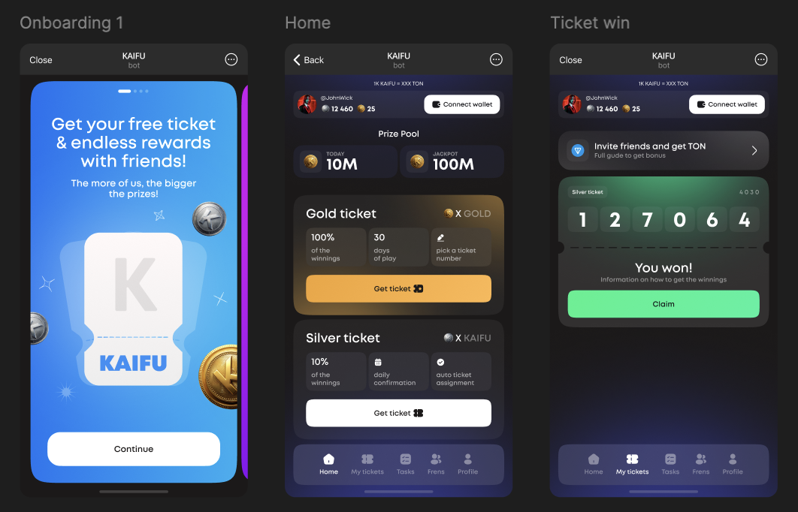
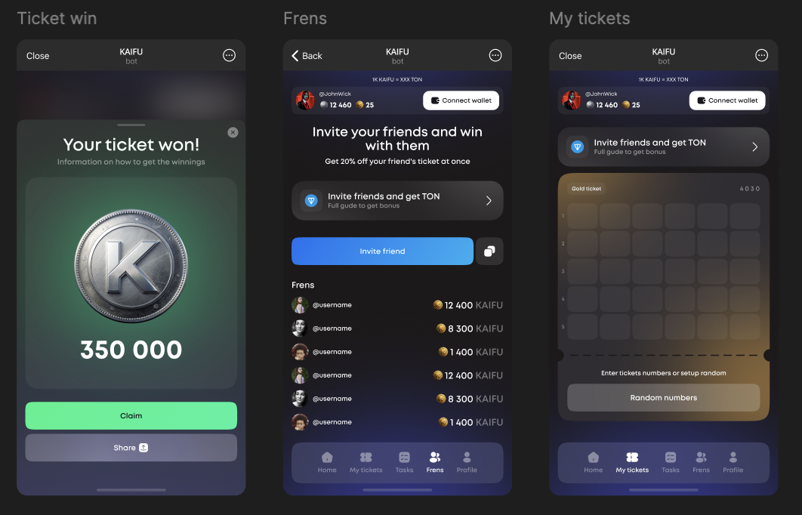
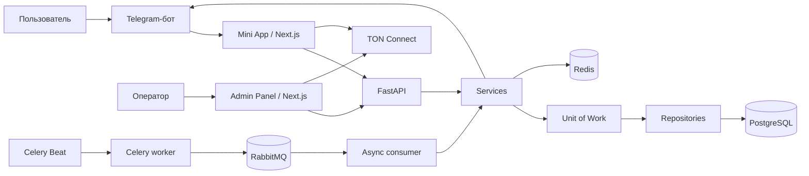

<div align="center">


# KAIFU

**Telegram Mini App, панель управления и асинхронный backend**

[Mini App](frontend/webapp) · [Админ-панель](frontend/admin) · [Запуск](docs/SETUP.md) · [Технический статус](docs/STATUS.md)

</div>

## О проекте

KAIFU — игровое приложение внутри Telegram, которое я самостоятельно разработал для заказчика. Проект объединяет пользовательское Mini App, веб-панель администратора, REST API, Telegram-бота и фоновые процессы розыгрышей. **Аудитория проекта составляла 10 000 пользователей.**

Я отвечал за весь цикл технической реализации: разработал интерфейсы, спроектировал базу данных и API, реализовал игровую логику, интеграции и обработку фоновых задач. В этом репозитории собраны исходники всех компонентов проекта.

## Дизайн приложения

Ниже — макеты Mini App из Figma: знакомство с приложением, главный экран, билеты, выигрыши и реферальная программа.



*Первый запуск, главный экран с призовым фондом и состояние выигрышного билета.*



*Получение выигрыша, приглашение друзей и выбор номеров билета.*

## Пользовательское приложение

Пользователь открывает KAIFU через Telegram-бота. В Mini App доступны профиль, внутренние балансы, золотые и серебряные билеты, выбор номера и просмотр выигрышей. Реферальная программа связывает приглашённых пользователей с пригласившим, а раздел заданий объединяет действия, за которые начисляются бонусы.

Для работы с кошельком я интегрировал TON Connect: подключение, запрос подписи транзакции пополнения и оформление заявки на вывод. Покупка через Telegram Stars использует invoice-ссылки. История объединяет денежные операции и выигрыши в одном разделе.

Интерфейс разработан на Next.js, React и TypeScript. Я адаптировал его к Telegram WebView, добавил навигацию через BackButton, системные уведомления, тактильную обратную связь и переключение русского и английского языков.

[Подробнее о Mini App →](frontend/webapp/README.md)

## Панель управления

Для оператора я разработал отдельное браузерное приложение. Оно объединяет статистику пользователей и денежных операций, управление балансами и блокировками, просмотр билетов и выигрышей, обработку заявок на вывод, параметры банка и настройки экономики.

В основе интерфейса — Ant Design: таблицы с поиском и сортировкой, формы редактирования и модальные окна. Для статистики я использовал графики Recharts. Панель обращается к административному API с отдельной авторизацией и проверкой уровня доступа.

[Подробнее об админ-панели →](frontend/admin/README.md)

## Backend и архитектура

Серверную часть я построил на FastAPI и асинхронном SQLAlchemy. PostgreSQL хранит пользователей, задания, билеты, выигрыши, историю покупок и денежных операций, банк и системные параметры. Авторизация использует проверку Telegram initData и JWT с подписью RS256.

Я разделил HTTP-обработчики, прикладные сервисы и репозитории. Unit of Work управляет общей сессией репозиториев и явными границами транзакций. Такое разделение позволяет вызывать игровую логику как из API, так и из фонового обработчика.

Для ежедневных розыгрышей я выделил отдельный процесс обработки. Celery Beat формирует задание по расписанию, worker получает его через Redis и публикует сообщение в RabbitMQ. Асинхронный consumer вызывает сервис розыгрыша. Redis также используется для хранения занятых номеров и конфигурации кеша API. Telegram-бот обеспечивает вход в приложение и уведомления пользователей.



## Технологии

| Компонент | Стек |
| --- | --- |
| Mini App | Next.js 14, React 18, TypeScript, Tailwind CSS, Ant Design, Axios |
| Панель управления | Next.js 14, React 18, TypeScript, Ant Design, Recharts |
| Backend | Python 3.12, FastAPI, Pydantic 2, Uvicorn |
| База данных | PostgreSQL, SQLAlchemy 2, asyncpg, Alembic |
| Фоновые процессы | Redis, Celery, Celery Beat, RabbitMQ, aio-pika, pika |
| Интеграции | Telegram WebApp SDK, aiogram 3, TON Connect, Telegram Stars invoice |
| Авторизация | HMAC, JWT RS256, cryptography, refresh-cookie |
| Окружение | Docker, Docker Compose |

## Структура репозитория

```text
frontend/
├── webapp/        # Telegram Mini App
└── admin/         # Панель управления
src/
├── admin/         # Административные API и статистика
├── auth/          # Авторизация пользователей и администраторов
├── user/          # Профили, рефералы, задания и история
├── system/        # Параметры экономики и денежные операции
├── lottery/       # Билеты, фонды, розыгрыши и выигрыши
├── task/          # Celery и RabbitMQ consumer
├── repository.py  # Общие операции с данными
├── uow.py         # Сессии и транзакции
└── main.py        # Точка входа FastAPI
bot/               # Telegram-бот и уведомления
alembic/           # Миграции базы данных
docs/              # Запуск и техническая документация
```

## Запуск и состояние исходников

Для API нужны Python 3.12, PostgreSQL и Redis. Фоновая обработка дополнительно использует RabbitMQ и процессы Celery. Mini App и панель управления устанавливаются отдельно через `npm ci` и запускаются на разных портах. Полная последовательность приведена в [инструкции запуска](docs/SETUP.md).

Я проверил сборку обоих frontend-приложений и выполнил 15 групп функциональных проверок backend: работу профилей и JWT, сохранение аватара, реферальные связи и бонусы, покупку серебряного билета, списание и административное изменение баланса.

В репозитории сохранена историческая версия проекта. Для повторного публичного запуска остаются доработки миграций и отдельных игровых и финансовых сценариев. Я описал их вместе с результатами проверки в [техническом статусе](docs/STATUS.md).
