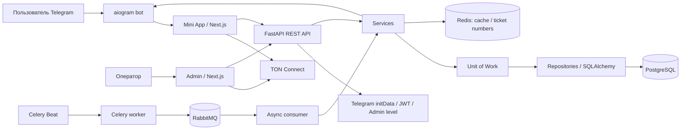

<div align="center">


# KAIFU

**Telegram Mini App · Admin Panel · Async Python Backend**

Игровое приложение внутри Telegram: билеты, розыгрыши, задания, рефералы и TON-кошелёк

**Самостоятельная fullstack-разработка для заказчика · ≈ 10 000 реальных пользователей¹**

[Возможности](#возможности) · [Архитектура](#архитектура) · [Моя работа](#моя-работа) · [Запуск](docs/SETUP.md) · [Кейс для портфолио](docs/PORTFOLIO.md)

</div>

---

## О проекте

**KAIFU** — клиентский проект, объединяющий Telegram Mini App для пользователей, веб-панель оператора, REST API и Telegram-бота. Пользователь открывает приложение из бота, приобретает игровые билеты, выполняет задания и приглашает друзей. Оператор работает с пользователями, балансами, транзакциями, статистикой и настройками экономики через отдельную админ-панель.

Я самостоятельно разработал проект целиком: оба frontend-приложения, backend, бота, схему базы данных и фоновую обработку. Проект запускался с реальными пользователями; по моим данным, аудитория составляла около **10 000 человек**.

¹ Под аудиторией я имею в виду общее число пользователей, а не одновременные подключения или результат нагрузочного теста.

> В этом репозитории я собрал исторические исходники проекта: оба клиентских приложения, API и фоновые процессы. В [техническом статусе](docs/STATUS.md) я описал результаты проверки и ограничения этой версии. Я сохраняю её как портфолио проекта; для нового production-запуска потребуется доработка.

## Возможности

### Telegram Mini App

Я разработал мобильное приложение на **Next.js, React и TypeScript** с русским и английским интерфейсом.

- **Вход через Telegram:** передача `initData`, создание профиля, onboarding и обработка реферального `start_param`.
- **Билеты:** золотые и серебряные билеты, покупка, активация, выбор номера, просмотр выигрышей и получение награды.
- **Профиль:** два внутренних баланса, аватар и объединённая история операций и выигрышей.
- **Реферальная программа:** персональные ссылки, список приглашённых, бонусы за приглашения и участие рефералов.
- **Задания:** подписки на Telegram и другие социальные платформы, фиксация выполнения и начисление бонусов.
- **TON Connect:** подключение кошелька, запрос подписи транзакции пополнения, заявка на вывод.
- **Telegram Stars:** получение invoice-ссылки и открытие оплаты через Telegram WebApp.
- **Telegram UX:** BackButton, всплывающие сообщения, haptic feedback, раскрытие WebView и переключение RU/EN.

[Код Mini App →](frontend/webapp) · [Описание и запуск →](frontend/webapp/README.md)

### Веб-панель администратора

Для оператора я разработал отдельное браузерное приложение на **Next.js, Ant Design и Recharts**.

| Раздел | Назначение |
| --- | --- |
| Статистика | Графики и показатели пользователей, денежных операций и билетов |
| Пользователи | Поиск, сортировка, редактирование балансов и флага блокировки |
| Транзакции | История пополнений и выводов, интерфейс TON-выплаты оператором |
| Банк | Управление фондами и параметрами банка |
| Билеты и выигрыши | Списки, поиск, сортировка и статусы получения |
| Розыгрыши | Ежедневные результаты и интерфейс jackpot |
| Настройки | Цены, курсы и параметры экономики |
| Доступ | Отдельная авторизация администратора и проверка уровня доступа на API |

[Код панели →](frontend/admin) · [Описание и запуск →](frontend/admin/README.md)

### Backend и фоновая обработка

- **Асинхронный REST API** на FastAPI с Pydantic-контрактами и OpenAPI.
- **Авторизация пользователей и администраторов:** проверка Telegram HMAC, JWT RS256, access/refresh-токены, проверка уровня администратора.
- **Игровая логика:** покупка и нумерация билетов, распределение средств между фондами, ежедневный розыгрыш, записи выигрышей и реферальные начисления.
- **PostgreSQL:** пользователи, администраторы, задания, билеты, выигрыши, покупки, денежная история, банк и системные параметры.
- **Redis:** backend кеша FastAPI, хранение занятых номеров и брокер Celery.
- **Celery + RabbitMQ:** расписание ежедневного задания, публикация сообщения и отдельный асинхронный consumer для обработки розыгрыша.
- **Telegram-бот:** запуск Mini App, инструкции, уведомления о выигрышах и активации билетов, создание Stars invoice-ссылок.

Наличие реализации не заменяет сквозной проверки платежей и розыгрышей. В частности, финальная обработка jackpot в сохранённом коде не завершена; для Stars есть обработчик `successful_payment`, но не найден обязательный обработчик `pre_checkout_query`. [Подробности →](docs/STATUS.md)

## Моя работа

В этом проекте я связал несколько частей одного продукта:

| Область | Что я реализовал |
| --- | --- |
| Пользовательский frontend | Мобильные экраны, навигация, onboarding, локализация, формы и wallet-сценарии |
| Административный frontend | Таблицы с поиском и сортировкой, редактирование данных, графики и формы управления |
| API и интеграции | Telegram WebApp-авторизация, JWT, TON Connect на клиенте, пользовательские и административные API |
| Данные и архитектура | Асинхронный SQLAlchemy, Repository, Unit of Work, схема PostgreSQL и миграции |
| Фоновые процессы | Celery Beat, передача задания через RabbitMQ и consumer розыгрышей |
| Окружение | Docker/Compose-файлы для приложений и сервисов |

## Архитектура



### Разделение слоёв

**Frontend** организован по функциональным разделам: страницы, компоненты, типы и API-функции расположены рядом. Общий Axios-клиент добавляет Bearer token и обрабатывает обновление сессии. React Context хранит состояние Telegram, навигации и шапки приложения.

**Backend** разделяет маршрутизацию, прикладные сервисы и SQL-репозитории. `UnitOfWork` предоставляет общую асинхронную сессию и явный `commit`, затем выполняет rollback незавершённой транзакции и закрывает сессию. Сценарий может использовать несколько таких границ: весь процесс покупки не заявляется единой атомарной транзакцией.

**Фоновые задачи** отделены от HTTP-запросов. Celery Beat ставит ежедневную задачу в Redis-брокер; worker публикует сообщение в RabbitMQ, а consumer вызывает сервис розыгрыша. В коде расписание задано на 17:00 UTC.

## Стек

| Слой | Технологии |
| --- | --- |
| Mini App | Next.js 14.0.1, React 18, TypeScript, Tailwind CSS, Ant Design, Axios |
| Admin Panel | Next.js 14.1.4, React 18, TypeScript, Ant Design, Recharts, Axios |
| Telegram / TON | Telegram WebApp SDK, aiogram 3, TON Connect UI React |
| API | Python 3.12, FastAPI, Pydantic 2, Uvicorn |
| Данные | PostgreSQL, SQLAlchemy 2, asyncpg, Alembic |
| Фоновые процессы | Redis, Celery, Celery Beat, RabbitMQ, aio-pika, pika |
| Авторизация | HMAC, JWT RS256, cryptography, refresh-cookie |
| Окружение | Docker, Docker Compose, npm lock-файлы |

## API

| Группа | Основные сценарии |
| --- | --- |
| `/auth/*` | Вход и обновление токенов пользователя и администратора |
| `/user/*` | Профиль, аватар, задания, друзья и история операций |
| `/system/*` | Курсы, цены и системные параметры |
| `/lottery/*` | Фонд, покупка и активация билетов, номера, выигрыши и invoice |
| `/admin/*` | Пользователи, деньги, банк, статистика, билеты и настройки |

После запуска API полные контракты доступны в Swagger UI на `/docs` и в `/openapi.json`.

## Структура

```text
frontend/
├── webapp/        # Telegram Mini App
└── admin/         # Веб-панель оператора
src/
├── admin/         # Административные API и статистика
├── auth/          # Telegram initData и JWT
├── user/          # Профили, рефералы, задания, история
├── system/        # Настройки экономики и денежные операции
├── lottery/       # Билеты, фонды, розыгрыши, выигрыши
├── task/          # Celery, producer и RabbitMQ consumer
├── redis_manager.py
├── repository.py  # Общие операции с данными
├── uow.py         # Сессия и транзакции
└── main.py        # FastAPI, lifespan, CORS и роутеры
bot/               # Telegram-бот и уведомления
alembic/           # Миграции PostgreSQL
docs/              # Запуск, проверки и портфолио-кейс
```

## Запуск и проверка

**[Инструкция запуска →](docs/SETUP.md)** · **[Результаты проверки →](docs/STATUS.md)**

Для основного API нужны Python 3.12, PostgreSQL и Redis. Для фонового контура дополнительно нужны RabbitMQ, Celery worker/Beat и consumer. Оба frontend-приложения устанавливаются отдельно через `npm ci` и запускаются на разных портах.

Для обновлённого backend я выполнил **15 успешных групп функциональных проверок** на отдельной локальной базе: профиль и JWT, сохранение аватара, реферальная связь и бонус, покупка серебряного билета и списание баланса, параметры, фонд и административные операции. Я также подтвердил ошибки исторической миграции. Оба frontend-приложения я ранее проверил production-сборкой и запросами HTML; последний backend-коммит не меняет их код.

В ходе этой проверки я не запускал реальные платежи, Telegram-уведомления и розыгрыши с пользователями. Для нового публичного развёртывания нужны восстановление недостающих миграций, начальные данные и отдельная проверка финансовых сценариев.

## Коротко для портфолио

> **KAIFU — мой fullstack-проект для заказчика.** Я самостоятельно разработал Telegram Mini App и админ-панель на Next.js / React / TypeScript, асинхронный backend на FastAPI / PostgreSQL и Telegram-бота. Реализовал сценарии билетов, рефералов, заданий и управления экономикой, подключил TON Connect на клиенте и организовал фоновую обработку на Celery / Redis / RabbitMQ. Проект запускался с реальными пользователями; по моим данным, аудитория составляла около 10 000 человек.

[Подробный кейс и текст для резюме →](docs/PORTFOLIO.md)
